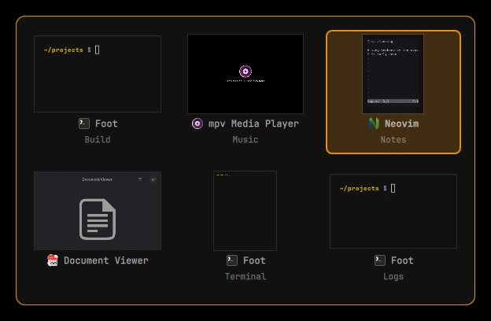

# omext switcher

Alt + Tab as a window switcher for [Omarchy](https://omarchy.org), part of
[omarchy-extended](https://github.com/omarchy-extended).



Hold **Alt** and press **Tab**: the open windows show in a list, the one you
used last first. Each Tab steps to the next (Shift + Tab steps back, the arrow
keys move too). Let go of Alt and you are at the window chosen. Escape leaves
everything as it was.

A quick Alt + Tab, let go at once, goes straight to the window you used before
this one without showing the list.

## Why

Omarchy's own Alt + Tab moves the focus to the next window, with nothing to
show where you are going or what else is open. Coming from Windows, the list
is what makes the key useful: you see every window, in the order you used
them, and stop on the one you want.

## What is in the list

- The windows on every workspace, on every screen.
- The apps in the [omext docks](https://github.com/omarchy-extended/docks),
  marked "Dock": choosing one opens its dock on it.
- Minimized windows, marked "Minimized": choosing one brings it back.

Each window shows as a live picture of itself, with its icon, app and title
under it (its icon alone, where Hyprland has no picture of it).

Dock apps and minimized windows can each be left out, in Omarchy's menu under
Setup › Omarchy Extended, or in `~/.config/omext/switcher.json`:

```json
{ "docked": false, "minimized": false }
```

## Install

Needs Omarchy 4.5 or later. [omext core](https://github.com/omarchy-extended/core)
is installed along with it.

```bash
git clone https://github.com/omarchy-extended/switcher.git ~/.local/share/omext-switcher
```

```bash
~/.local/share/omext-switcher/install.sh
```

To remove it again (Alt + Tab is Omarchy's own once more):

```bash
~/.local/share/omext-switcher/uninstall.sh
```

## How it works

A service plugin for the Omarchy shell draws the list. Hyprland binds Alt + Tab,
Alt + Shift + Tab and the release of Alt to global shortcuts the plugin
registers, so no program is started per keypress. The keys are only taken
while the plugin is on.

## The order

Last used first, by the switcher's own record. Hyprland's focus history counts
every window the pointer passed over (the focus follows the mouse), so it is
not the order you worked in. Here a window counts as used once the focus has
rested on it for a moment (0.7 s), or when you chose it in the list. Windows
with no record yet, such as after the shell starts, come after the others in
Hyprland's order.
